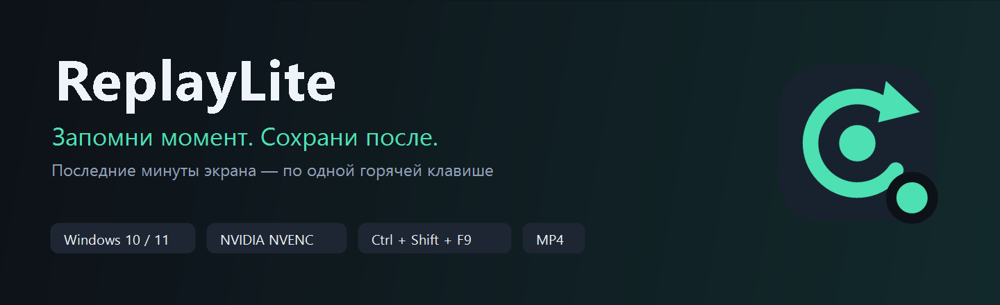
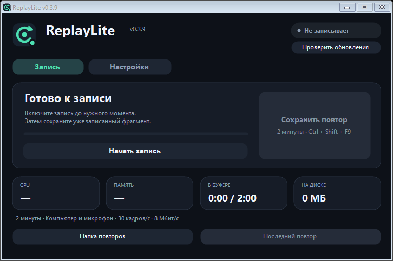
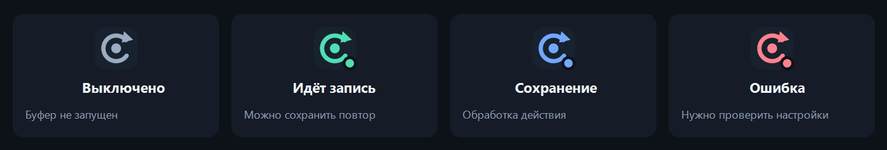

<p align="center">
  
</p>

<h1 align="center">ReplayLite</h1>

<p align="center">
  <strong>Последние минуты экрана — в MP4 по одной горячей клавише.</strong><br>
  Запись через NVIDIA NVENC, звук компьютера и микрофона, работа в трее.
</p>

<p align="center">
  <a href="https://github.com/DraimCiDo/ReplayLite/releases/latest">Скачать для Windows</a> ·
  <a href="#быстрый-старт">Быстрый старт</a> ·
  <a href="docs/GUIDE.md">Подробная инструкция</a> ·
  <a href="https://github.com/DraimCiDo/ReplayLite/issues">Предложения и ошибки</a>
</p>

<p align="center">
  <a href="https://github.com/DraimCiDo/ReplayLite/actions/workflows/build-release.yml"></a><br>
  Windows 10/11 x64 · NVIDIA NVENC · H.264 + AAC · .NET Framework 4.8
</p>

---

## Сохраняй то, что уже произошло

Удачный момент в игре, важная демонстрация или неожиданная ошибка на экране — ReplayLite держит последние минуты в буфере. Нажми **Ctrl + Shift + F9**, и уже записанный фрагмент сохранится в MP4.

По умолчанию это **2 минуты, 30 FPS, 8 Мбит/с, звук компьютера + микрофон**. Длительность можно выбрать от **30 секунд до 10 минут**. Во время сохранения запись продолжается.

## Как выглядит

<p align="center">
  
</p>

Панель записи показывает состояние буфера и кнопку сохранения. Ниже — CPU, память, заполнение буфера и место на диске. Папка и последний сохранённый повтор открываются прямо из окна.

## Возможности и преимущества

| Возможность | Что это даёт |
| --- | --- |
| **Запись последних минут** | Сохраняй событие после того, как оно произошло. |
| **Аппаратное кодирование NVENC** | Видео кодируется отдельным блоком NVIDIA; CPU не выполняет программное кодирование видео. |
| **Сжатый буфер на диске** | Приложение не держит минуты несжатого видео в RAM. Старые фрагменты удаляются. |
| **MP4 без повторного кодирования** | Сохранение переносит готовые видеопотоки в итоговый файл. |
| **Звук компьютера и микрофона** | Игровой звук и голос попадают в одну стереодорожку; доступны режимы «только компьютер» и «без звука». |
| **Работа в трее** | Сохраняй повтор и управляй буфером без открытого окна. |
| **Короткие анимации** | Переходы длятся 150–200 мс и останавливаются после скрытия окна. |
| **Локальная работа** | Записи остаются на компьютере. Для работы приложения не нужны аккаунт или интернет. |

## Значок, который показывает состояние

<p align="center">
  
</p>

Двойной щелчок открывает окно. Правый щелчок открывает меню сохранения, включения/остановки буфера, папки повторов и выхода. Закрытие окна отправляет приложение в трей; для полного завершения выбери **«Выход»**.

## Быстрый старт

1. Открой [последний релиз](https://github.com/DraimCiDo/ReplayLite/releases/latest) и скачай **ReplayLite-Windows.zip**.
2. Распакуй **всю папку** в место, где у тебя есть право записи, и запусти **ReplayLite.exe**.
3. Выбери настройки и нажми **«Включить буфер»**.
4. Сохрани момент кнопкой **«Сохранить повтор»** или **Ctrl + Shift + F9**.

MP4 появится в выбранной папке. Поначалу сохраняется уже накопленная часть; полный двухминутный буфер доступен после двух минут записи.

> Для первой установки используй ZIP: он содержит приложение и зависимости. Отдельный `ReplayLite.exe` в Releases предназначен для обновления файла в уже распакованной папке. Требуются Windows 10/11 x64, .NET Framework 4.8 и NVIDIA с поддержкой NVENC. Исполняемый файл не подписан.

## Что с нагрузкой

Локальный тест ядра записи: **RTX 4060 · Ryzen 7 5700X · 2560×1440 · 30 FPS · 8 Мбит/с · буфер 120 секунд · компьютер + микрофон**.

| Показатель | Результат проверки |
| --- | --- |
| Средний CPU тестового приложения + FFmpeg | **0,53%** от всех 16 логических процессоров |
| Пиковая RAM тестового приложения + FFmpeg | **158,3 МиБ** |
| Размер кольцевого буфера с запасом | **130,4 МиБ** |
| GPU VideoEncode, четыре отдельные выборки | **5–7%** |
| Длительность полного сохранённого MP4 | **120,016 с** |

Это результаты записи рабочего стола, не игрового бенчмарка и не гарантия для другого компьютера. RAM/CPU измерены без основного окна, VideoEncode — отдельный блок GPU. Влияние на игровой FPS и общая загрузка GPU/VRAM отдельно не измерены. [Полная проверка записи](VALIDATION.md) · [Проверка нового интерфейса](UI-VALIDATION.md).

## Что учитывать

- Записывается **весь выбранный экран в исходном разрешении**, включая курсор. Захват отдельного окна/игры пока не реализован.
- **AMD и Intel не поддерживаются** этой версией. Требуется NVIDIA NVENC.
- Сохранение обычно ждёт до **2 секунд**, пока закроется текущий фрагмент. Ролик может включать до двух секунд после нажатия.
- Звук компьютера и микрофона смешивается в **одну дорожку**. Для микрофона Windows должна разрешать доступ классическим приложениям.
- При 8 Мбит/с запись пишет примерно **1 МБ/с**. Сохранённые MP4 автоматически не удаляются.
- HDR, защищённый контент и эксклюзивный полноэкранный режим отдельно не проверены.

Остальные настройки, поведение после сна и устранение ошибок — в [подробной инструкции](docs/GUIDE.md).

## Собрать из исходников

```powershell
git clone https://github.com/DraimCiDo/ReplayLite.git
cd ReplayLite
.\source\setup-deps.ps1
.\source\build.ps1
.\ReplayLite.exe
```

Для загрузки закреплённых зависимостей нужен интернет; SHA256 проверяется. Сборка использует компилятор .NET Framework из Windows, дополнительный .NET SDK не нужен. После сборки приложение работает без сети.

## Сборки и Releases

[GitHub Actions](https://github.com/DraimCiDo/ReplayLite/actions/workflows/build-release.yml) собирает EXE и проверяет интерфейс на Windows. Для push в `main` и pull request публикуется артефакт сборки. Push тега вида **`v0.2.2`**, совпадающего с файлом `VERSION`, дополнительно создаёт GitHub Release с **EXE**, **готовым ZIP** и **SHA256SUMS.txt**.

В CI нет NVIDIA для проверки захвата: реальные проверки записи выполнены локально и описаны выше. [Как выпустить версию](docs/RELEASING.md) · [История изменений](CHANGELOG.md).

## Разработка

| Файл / папка | Назначение |
| --- | --- |
| `source/ReplayLite.cs` | Захват, аудио, кольцевой буфер и экспорт |
| `source/MainForm.cs` | Управление программой и состояния трея |
| `source/Ui.cs` | Контролы, короткие анимации и рисование иконок |
| `source/build.ps1` | Сборка EXE с иконкой и версией |
| `source/package.ps1` | Подготовка переносимого релиза |
| `assets/` | Иконки, баннер и PNG интерфейса |
| `.github/workflows/` | Автоматическая сборка и публикация |

Нашёл ошибку или хочешь предложить функцию? [Создай issue](https://github.com/DraimCiDo/ReplayLite/issues/new), указав видеокарту, версию Windows и шаги воспроизведения. Не прикладывай записи с личными данными.

**Компоненты:** FFmpeg 9.0.2, NAudio 1.10.0, WinForms/GDI+. Лицензии и происхождение зависимостей — в [THIRD-PARTY.md](THIRD-PARTY.md). Исходники и лицензии сторонних компонентов входят в переносимый ZIP в объёме, описанном в этом файле.
